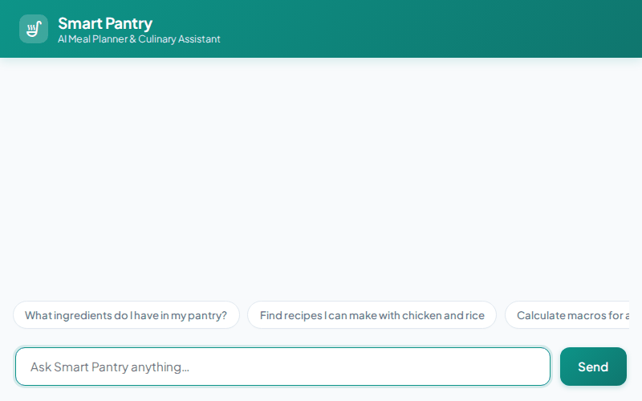

# 🥗 Smart Pantry AI Agent

An intelligent AI culinary assistant and meal planning engine built with the **Google Agent Development Kit (ADK)**. Smart Pantry manages long-term user dietary preferences and allergies, queries Cloud Firestore recipe collections, calculates nutritional breakdowns, searches public recipe databases, locates nearby grocery stores via Google Maps, and generates dish photos and cooking videos using Google Gemini & Omni models.



---

## 🚀 Key Implemented Features

### 🧠 Long-Term Memory Bank
- **Memory Preloading**: Preloads stored user memories (allergies, dietary goals, favorite ingredients) at session start via `PreloadMemoryTool`.
- **Automatic Memory Synthesis**: Automatically extracts and saves new user allergies and restrictions across turns via `generate_memories_callback`.

### 🗄️ Cloud Firestore Database Integration
- **Recipe Management**: Directly queries and updates the `recipes` collection in Cloud Firestore:
  - `list_recipes`: Retrieves all saved pantry recipes.
  - `get_recipe_details`: Pulls step-by-step instructions and ingredient lists.
  - `add_recipe`: Persists new recipes to Firestore.

### 🎨 Media Generation & Cloud Storage
- **Gemini Dish Image Generation**: Uses `gemini-3.1-flash-lite-image` in the `global` region (`generate_recipe_image`) to generate dish photography, saving Playground artifacts and uploading bytes directly to Google Cloud Storage.
- **Google Omni Video Generation**: Uses Google's Omni model (`gemini-omni-flash-preview`) in the `global` region (`generate_recipe_video`) to create culinary video clips.
- **Public Cloud Storage Bucket**: Uploads image and video bytes directly to Google Cloud Storage and returns public HTTPS URLs.

### 📊 Nutrition & External Recipe Integration
- **Nutritional Calculation**: Computes exact calorie counts and macro breakdowns (protein, fat, carbs) scaled by target serving sizes (`calculate_recipe_nutrition`).
- **TheMealDB API Integration**: Searches public recipe repositories online (`search_online_recipes`).

### 🗺️ Google Maps & Location Services
- **Geocoding API**: Resolves user addresses or landmarks to coordinates (`geocode_address`).
- **Places API**: Finds nearby grocery stores, bakeries, or supermarkets (`find_nearby_places`).

### 🎛️ A2UI Structured UI Rendering
- **A2UI Schema Manager (v0.8)**: Generates structured, responsive A2UI card layouts (`Card`, `Column`, `Row`, `Text`, `Image`) rendered directly in the chat interface.

### 💻 Code Execution
- **Python Sandbox**: Executes code snippets in an isolated ADK environment (`code_executor`).

---

## 🛠️ Local Setup & Running Instructions

### 1. Prerequisites
- Python 3.10+
- Google Cloud Project with Vertex AI, Firestore, and Cloud Storage enabled
- Authenticated `gcloud` CLI (`gcloud auth application-default login`)

### 2. Install Dependencies
```bash
pip install -r requirements.txt
```

### 3. Environment Variables
Configure your environment variables:
```bash
export GOOGLE_CLOUD_PROJECT="<your-gcp-project-id>"
export AGENT_ENGINE_RESOURCE_NAME="projects/<project-number>/locations/<region>/reasoningEngines/<engine-id>"
export AGENT_DIRECTORY="app"
export PORT=8080
```

### 4. Run Local FastAPI Frontend Proxy
```bash
python main.py
```
The server starts on port `8080`. Open your web browser to view and interact with the Smart Pantry Chat UI.

---

## 📂 Project Architecture

```
smart-pantry/
├── app/
│   ├── __init__.py
│   └── agent.py              # Main ADK Agent, tools, and memory callbacks
├── frontend/
│   ├── main.py               # FastAPI proxy server for A2A deployment
│   └── static/
│       └── index.html        # Rebranded Smart Pantry chat UI
├── agents-cli-manifest.yaml   # Manifest for agents-cli deployment
├── deployment_metadata.json  # Reasoning Engine deployment metadata
├── agent_demo.gif            # Looping demo video GIF
├── agent_demo.webm           # Screen recording webm
└── requirements.txt          # Python dependencies
```
